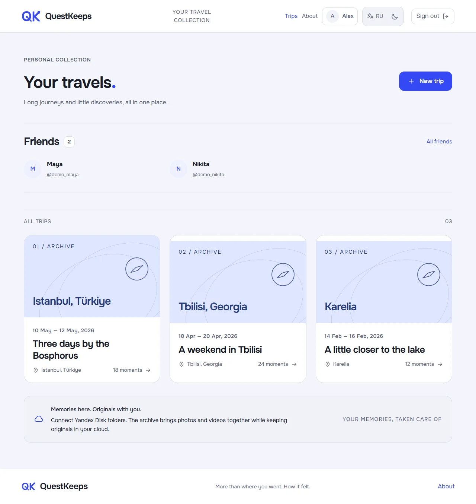
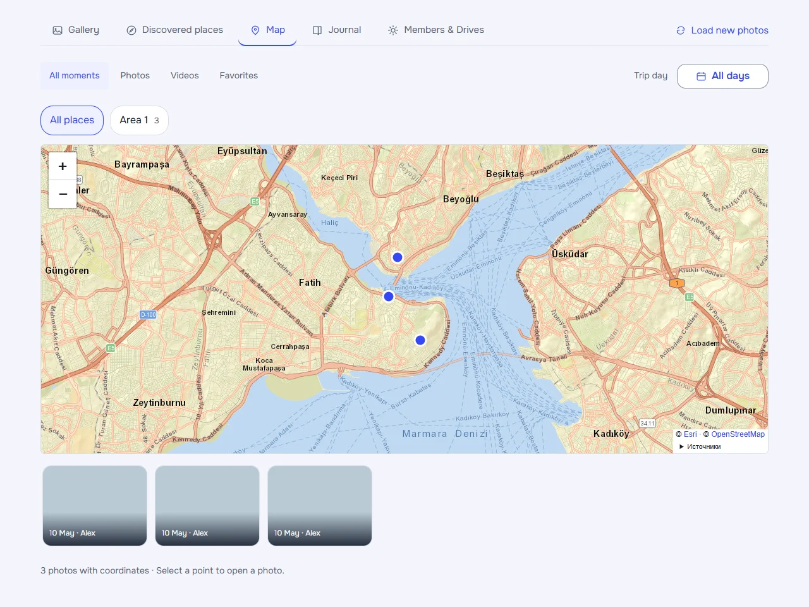
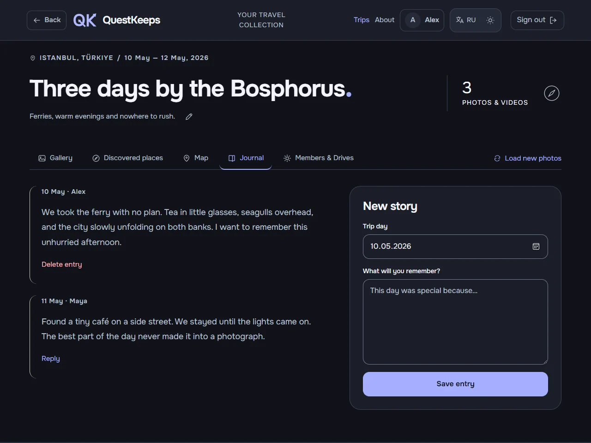
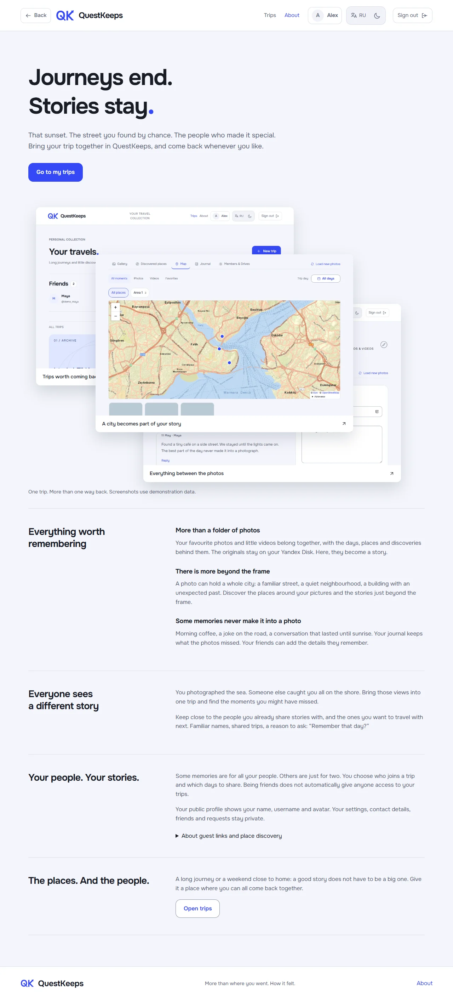
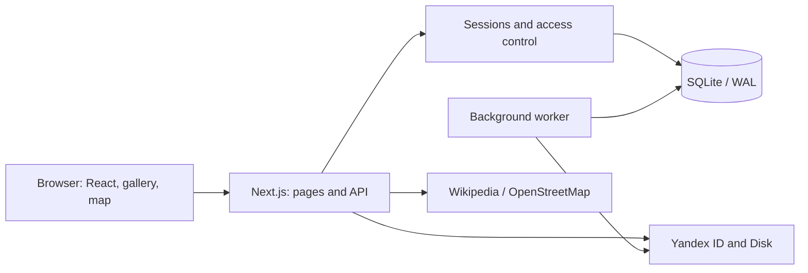

# QuestKeeps

**English** | [Русский](README.ru.md)


**Trips end. Stories stay.**

QuestKeeps brings photos, routes, discovered places and journal entries together into a travel story, shared with the people who were there. Original photos and videos stay on Yandex Disk; the application connects them to dates, places and memories.

A full-stack personal project built with **Next.js, React and TypeScript**, featuring SQLite, background indexing, OAuth and server-side access control. Current version: **1.13.0**.

## Screenshots

These screenshots show the running application with fictional data and placeholder photo previews. They contain no personal accounts, private photos or secret sharing links.

### Your travel collection



### Places on the map



### A shared journal in dark mode



<details>
<summary>About the project</summary>



</details>

Light and dark themes, English and Russian interfaces, and responsive layouts. The Onest font is served locally. The screenshot showcase on the About page supports keyboard navigation and reduced motion.

## Features

- **Trips and shared stories.** Destinations, dates, descriptions with friend mentions, and participants with individual access periods.
- **Photos and videos from Yandex Disk.** Connect a selected folder, index it recursively, and synchronize manually or periodically without duplicating files.
- **Gallery.** Filter by day and media type, save favorites, rename photos within the application, view and download originals. Authors can hide their own publications from everyone or only from guests with a shared link, including after leaving a trip.
- **Maps and discoveries.** Coordinates from available EXIF metadata, manual location selection, Wikipedia landmark suggestions, and confirmed places near photos.
- **Journal.** Entries organized by trip day, with replies from participants.
- **Profiles and friends.** Usernames, avatars, public profiles, people search, friend requests and invitation links.
- **Multiple sign-in options.** Email or username and password, plus Yandex ID. Once Yandex is linked, either method opens the same profile.
- **Guest access.** A separate link to the published trip story, distinct from participant invitations. The owner can replace or revoke it.

Friendship alone does not grant access to trips. Participants see content within their assigned dates; a guest link grants access to the published story of the entire trip.

## Architecture



- **Frontend:** React 19, Next.js 16 App Router, TypeScript, Leaflet, and CSS with shared design tokens.
- **Backend:** API Route Handlers, Zod, SQLite through `better-sqlite3`, and versioned database migrations.
- **Identity:** bcrypt, HttpOnly sessions, OAuth state and PKCE. OAuth tokens are encrypted with AES-256-GCM; session and secret-link tokens are stored as hashes.
- **Synchronization:** a separate process, protection against concurrent scans, and repeatable indexing without duplicates. Failed scans do not clear the existing index.
- **Media:** streaming through the server with access checks, video Range requests, bounded EXIF reads, and browser-side preview caching.
- **Operations:** Nginx, systemd, HTTPS, and online SQLite backups on persistent VPS storage.

SQLite stores users, trips, permissions, media metadata, places, notes and background jobs. Original media files are not stored on the application server. JSON files hold translations, reference datasets and test fixtures, rather than user accounts or trips.

## Run locally

You need **Node.js 24 LTS**, npm, and persistent storage for SQLite. Native dependencies may require your operating system's build tools if a prebuilt binary is unavailable.

### 1. Install dependencies

Clone this repository and open its root directory:

```sh
npm ci
node -e "const fs = require('node:fs'); fs.copyFileSync('.env.example', '.env.local', fs.constants.COPYFILE_EXCL)"
```

The copy command does not overwrite an existing `.env.local`.

### 2. Configure the environment

Generate two independent secrets:

```sh
node -e "const { randomBytes } = require('node:crypto'); for (const key of ['TOKEN_ENCRYPTION_KEY', 'CRON_SECRET']) console.log(key + '=' + randomBytes(32).toString('hex'))"
```

Replace the corresponding placeholders in `.env.local` with the generated lines. Other main settings:

- `APP_URL=http://localhost:3000` — application URL.
- `DATABASE_PATH=./data/travel.sqlite` — database path.
- `YANDEX_CLIENT_ID` and `YANDEX_CLIENT_SECRET` — required for Yandex ID and Disk synchronization; leave them empty to explore the rest of the application.

Secrets and the user-data directory `data/` are excluded from Git. Keep `TOKEN_ENCRYPTION_KEY` safe: replacing it makes existing encrypted OAuth tokens unreadable.

### 3. Start the application

```sh
npm run migrate
npm run dev
```

Open [localhost:3000](http://localhost:3000). Register with an email address, create a trip and write your first journal entry. The web application and worker start together; press `Ctrl+C` to stop them. The worker checks jobs every 30 seconds, with each source scheduled for synchronization at 15-minute intervals.

Local development uses `.next-dev`, production build/start uses `.next`, and browser tests use `.next-e2e`. Use `npm run dev` while editing: a production process must be restarted after its build files are replaced.

## Connect Yandex Disk

1. Create a sign-in application in [Yandex OAuth](https://oauth.yandex.ru/).
2. Add a web-platform Redirect URI: `http://localhost:3000/api/auth/callback`.
3. Configure `login:info`, `login:email`, `cloud_api:disk.read`, and avatar access through `login:avatar`. Avatar access is requested as an optional permission.
4. Set `YANDEX_CLIENT_ID` and `YANDEX_CLIENT_SECRET` in `.env.local`, then restart the application.
5. Sign in to your existing profile and link Yandex in your profile settings. Open Participants & Disks in a trip and select a folder.

Each user can have one active connected Disk account at a time. Participants connect their own accounts; another participant's folder requires approval from the trip owner. Disconnecting Disk removes tokens and pauses synchronization while keeping trip history.

**Permission boundary:** Yandex grants OAuth read access to Disk. Restricting indexing to the selected folder is enforced by QuestKeeps itself, rather than a provider-issued permission for that single folder. The application does not request write access.

For a deployment, add the matching HTTPS callback to the same OAuth application and set its public URL in `APP_URL`.

## Checks

GitHub Actions runs these checks for pushes to main and pull requests, using isolated test data. See [architecture](docs/ARCHITECTURE.md) for module boundaries.

```sh
npm run format:check
npm run typecheck
npm test
npm run build
npm run test:e2e
```

Unit/API tests use separate SQLite files, dummy keys and mocked external requests. They cover owner, participant and guest permissions, date boundaries, file ownership, sessions, OAuth, migrations, synchronization and friend links.

Browser tests start a separate environment on port `3101` with an isolated database and no background synchronization. Playwright is configured to use **an installed Microsoft Edge browser** (`channel: msedge`). Tests include both themes, localization, keyboard interaction and axe accessibility checks. No personal accounts or files are required.

Additional commands:

```sh
npm run health
npm run backup
```

The first checks database schema, integrity and configuration presence. The second creates a consistent SQLite snapshot in `data/backups/`, accounting for WAL.

## Deployment

Use an always-running Node.js server with persistent storage. An ephemeral serverless filesystem is unsuitable for this SQLite database and background worker.

```sh
npm ci
npm run migrate
npm run build
npm start
```

`npm start` already starts the worker. Do not run `npm run worker` alongside it. The application listens on loopback; Nginx handles external HTTPS requests.

See [deploy/README.md](deploy/README.md) for server configuration, certificates, backups and rollback. Build the application and native dependencies on the target operating system. Transfer the database and encryption key separately from the source code.

## Current limitations

- Cloud storage integration supports Yandex Disk; Google Drive is not connected yet.
- An email-verification queue and Resend delivery are implemented. Verification is disabled by default and requires a configured sender, domain and API key. Telegram notifications for new registrations are not implemented yet.
- Video playback depends on browser format and codec support; there is no server-side transcoding. EXIF extraction is bounded by data size and format support; locations can be set manually.
- Revoking a guest link cannot revoke files that have already been viewed or downloaded.
- Password recovery, email changes and account deletion are not implemented yet.
- Automated tests do not replace manual testing with real media or a completed security audit. Review scope and status are documented in [docs/SECURITY.md (Russian)](docs/SECURITY.md).

Interface copy uses typed keys from [Russian and English JSON locales](docs/I18N.md). [Code style](docs/CODE_STYLE.md) is enforced with formatting and unused-code checks; the latest [focused code review](docs/CODE_REVIEW.md) records fixes and remaining refactoring work.

## Source layout

- `app/` — pages and API routes.
- `components/` — interface, gallery, map, profile and About page.
- `lib/access.ts`, `lib/api.ts`, `lib/api/` — access control, dispatcher and domain handlers.
- `lib/contracts.ts`, `components/archive/` — shared domain types and archive controller/views.
- `lib/db.ts`, `lib/migrations/` — database, encryption and migrations.
- `lib/yandex.ts`, `lib/sync.ts`, `lib/photo-metadata.ts` — Disk integration, indexing and metadata.
- `lib/places.ts`, `lib/data/` — places and localized geographic names.
- `scripts/` — startup, worker, checks, backups and demonstration screenshots.
- `tests/`, `e2e/` — automated checks.
- `deploy/` — VPS configuration.

## Credits and project history

Sign-in photography comes from Pexels; geographic data from GeoNames; maps from Esri and OpenStreetMap; landmark descriptions from Wikipedia. Sources and attribution:

- [Photography credits (Russian)](docs/WELCOME-PHOTOS.md).
- [Demonstration screenshots and capture instructions (Russian)](docs/ABOUT-SCREENSHOTS.md).
- [GeoNames reference data](lib/data/README.md).
- [Changelog (Russian)](CHANGELOG.md) and [versioning policy (Russian)](docs/VERSIONING.md).

Documentation and screenshots reflect the current interface. The proposed design experiment will be a separate change.
