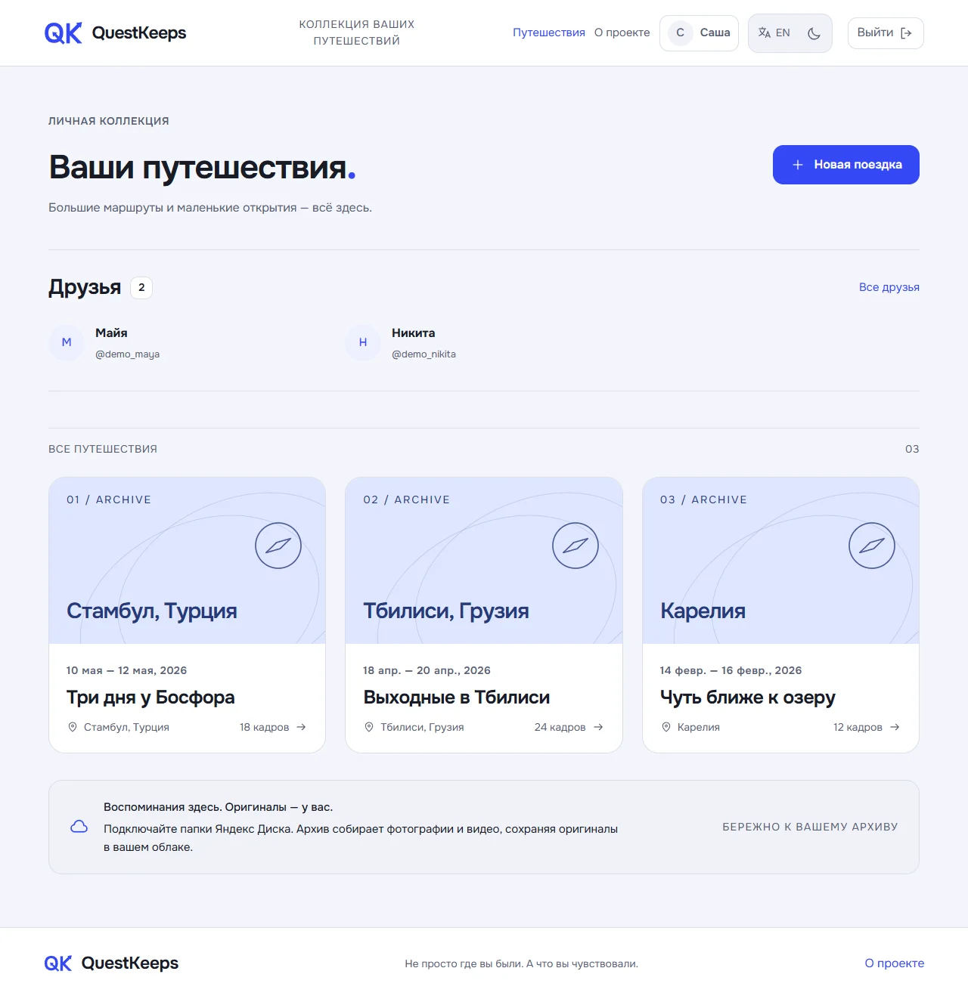
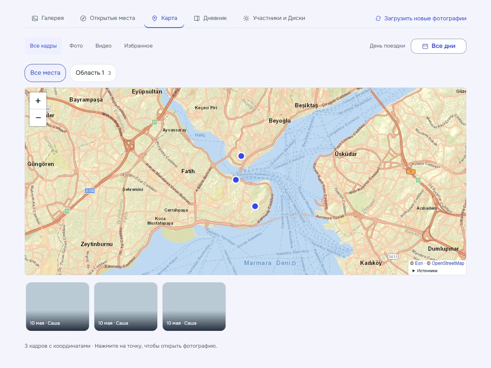
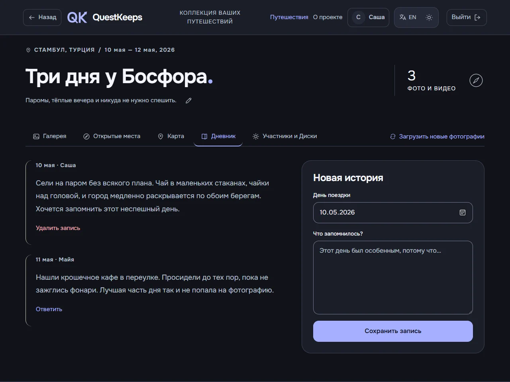
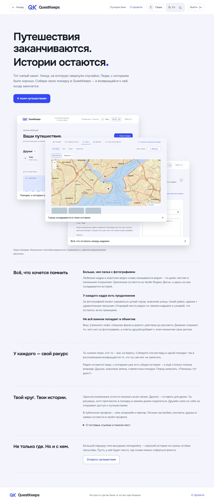
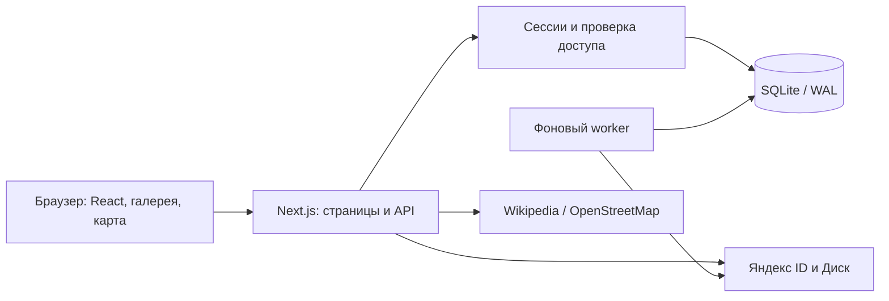

# QuestKeeps

[English](README.md) | **Русский**


**Путешествия заканчиваются. Истории остаются.**

QuestKeeps собирает фотографии, маршруты, открытые места и записи в дневнике в историю поездки — вместе с людьми, которые были рядом. Оригиналы фото и видео остаются на Яндекс Диске, а приложение связывает их с датами, местами и воспоминаниями.

Full-stack пет-проект на **Next.js, React и TypeScript** с SQLite, фоновым индексированием, OAuth и серверной проверкой прав доступа. Текущая версия — **1.28.0**.

- **Лучшие кадры.** Посты и истории создаются из избранных фотографий, доступных гостям. Обложки поездок сменяют избранные кадры; без них остаётся иллюстрация архива.
- **Живые уведомления.** Заявки и принятие дружбы, приглашения и новые кадры с Диска собраны в одном колокольчике. Открытая вкладка обновляется каждые 15 секунд; проверка Диска ставится в очередь один раз за вход. Уведомления сохраняются приватно для аккаунта.

## Как это выглядит

Скриншоты сняты с работающего интерфейса на вымышленных данных; превью фотографий заменены демонстрационными заглушками. Личные аккаунты, фотографии и секретные ссылки в них не используются.

### Коллекция путешествий



### Места на карте



### Дневник в тёмной теме



<details>
<summary>Страница «О проекте»</summary>



</details>

Светлая и тёмная темы, русский и английский интерфейс, адаптивная вёрстка. Шрифт Onest хранится локально. Композиция скриншотов на странице «О проекте» поддерживает клавиатуру и уменьшенное движение.

## Возможности

- Перелистывание кадров кнопками и стрелками клавиатуры, сохранение поворота на 90° и удаление своих кадров из поездки без удаления оригиналов с Яндекс Диска. Удалённые кадры исключаются из следующих синхронизаций.

- **Отслеживание поездок.** Кнопка со звездой над счётчиком фотографий сохраняет гостевую поездку в личный раздел архива. Действие продолжается после входа; отслеживание учитывает гостевую видимость и отзыв ссылки.

- **Обратная связь в Telegram.** Отзывы с текстом и вложениями, обработка администратором, email последних пользователей и уведомления о регистрациях. См. [настройку бота](docs/TELEGRAM-SETUP.md).

- **Поездки и общая история.** Направление, даты, описание с упоминаниями друзей и участники с обязательными датами участия и выбором просмотра своего периода или всей поездки. Приглашения по ссылке или внутри сервиса, поиск по никнейму/email и уведомления с принятием.
- **Фото и видео из Яндекс Диска.** Подключение выбранной папки, рекурсивное индексирование, ручная и периодическая синхронизация без дублирования файлов.
- **Управление кадрами.** Перелистывание текущей галереи кнопками и клавиатурой, сохранение поворота на 90° и удаление своих кадров из поездки без удаления оригиналов с Яндекс Диска. Исключённые кадры не возвращаются при синхронизации.
- **Галерея.** Фильтры по дням и типам, избранное, собственные названия кадров, просмотр и скачивание оригиналов. Автор может скрыть свои публикации для всех или только для гостей по ссылке, в том числе после выхода из поездки.
- **Карта и открытия.** Координаты из доступных EXIF-метаданных, ручной выбор места, предложения достопримечательностей из Wikipedia и подтверждённые места рядом с кадрами.
- **Дневник.** Записи по дням поездки и ответы участников.
- **Профиль и друзья.** Никнейм, аватарка, публичная страница, поиск людей, заявки и ссылки для добавления в друзья.
- **Несколько способов входа.** Email или никнейм с паролем, Яндекс ID. После привязки Яндекса оба способа ведут в один профиль.
- **Гостевой просмотр.** Отдельная от приглашения участника ссылка на опубликованную историю поездки. Её можно заменить или отозвать.

Дружба сама по себе не открывает поездки. Участник видит данные в пределах выданных дат; обладатель гостевой ссылки — опубликованную историю всей поездки.

## Устройство проекта



- **Интерфейс:** React 19, Next.js 16 App Router, TypeScript, Leaflet и CSS с общими токенами оформления.
- **Сервер:** API Route Handlers, Zod, SQLite через `better-sqlite3`, версионируемые миграции.
- **Идентификация:** bcrypt, HttpOnly-сессии, OAuth state и PKCE. OAuth-токены шифруются AES-256-GCM; токены сессий и секретных ссылок хранятся в виде хешей.
- **Синхронизация:** отдельный процесс, блокировка параллельных проходов, повторное индексирование без дублей. Неуспешный проход не очищает существующий индекс.
- **Медиа:** потоковая передача через сервер с проверкой доступа, Range-запросы для видео, ограниченное чтение EXIF и кеш превью в браузере.
- **Эксплуатация:** Nginx, systemd, HTTPS и онлайн-бэкапы SQLite на постоянном диске VPS.

В SQLite хранятся пользователи, поездки, права, метаданные медиа, места, заметки и служебные задания. Оригиналы медиа не складываются на сервер приложения. JSON используется для переводов, справочников и фикстур, а не как хранилище аккаунтов и поездок.

## Локальный запуск

Нужны **Node.js 24 LTS**, npm и постоянная папка для SQLite. Для нативных зависимостей при отсутствии готового бинарного пакета могут потребоваться инструменты сборки ОС.

### 1. Установить зависимости

Склонируй репозиторий и открой его корневую папку:

```sh
npm ci
node -e "const fs = require('node:fs'); fs.copyFileSync('.env.example', '.env.local', fs.constants.COPYFILE_EXCL)"
```

Команда копирования не перезаписывает существующий `.env.local`.

### 2. Настроить окружение

Сгенерируй два независимых секрета:

```sh
node -e "const { randomBytes } = require('node:crypto'); for (const key of ['TOKEN_ENCRYPTION_KEY', 'CRON_SECRET']) console.log(key + '=' + randomBytes(32).toString('hex'))"
```

Вставь полученные строки в `.env.local` вместо значений-заглушек. Остальные основные параметры:

- `APP_URL=http://localhost:3000` — адрес приложения.
- `DATABASE_PATH=./data/travel.sqlite` — путь к базе.
- `YANDEX_CLIENT_ID` и `YANDEX_CLIENT_SECRET` — нужны для Яндекс ID и синхронизации Диска; для знакомства с остальным интерфейсом их можно оставить пустыми.

Секреты и пользовательская папка `data/` исключены из Git. Сохрани `TOKEN_ENCRYPTION_KEY`: при его замене существующие OAuth-токены перестанут расшифровываться.

### 3. Запустить приложение

```sh
npm run migrate
npm run dev
```

Открой [localhost:3000](http://localhost:3000). Можно зарегистрироваться по email, создать поездку и написать первую запись. Сайт и worker запускаются вместе; остановка — `Ctrl+C`. Worker проверяет почтовую очередь каждые 5 секунд независимо от синхронизации Диска; очередная синхронизация источника выполняется с интервалом 15 минут.

Локальная разработка использует `.next-dev`, production-сборка/запуск — `.next`, браузерные тесты — `.next-e2e`. При доработке сайта используйте `npm run dev`: production-процесс нужно перезапускать после замены его сборки.

## Подключение Яндекс Диска

1. Создай приложение для авторизации в [Яндекс OAuth](https://oauth.yandex.ru/).
2. Для веб-платформы добавь Redirect URI: `http://localhost:3000/api/auth/callback`.
3. Настрой разрешения `login:info`, `login:email`, `cloud_api:disk.read` и доступ к аватарке `login:avatar`. Приложение запрашивает аватарку как необязательное разрешение.
4. Заполни `YANDEX_CLIENT_ID` и `YANDEX_CLIENT_SECRET` в `.env.local`, перезапусти приложение.
5. Войди в существующий профиль и подключи Яндекс через настройки профиля. Затем в поездке открой «Участники и Диски» и выбери папку.

Одновременно у пользователя может быть один активный подключённый Диск. Участники подключают свои аккаунты; папка другого участника требует одобрения владельца поездки. Отключение Диска удаляет токены и приостанавливает синхронизацию, сохраняя историю поездок.

**Граница разрешения:** Яндекс выдаёт OAuth-доступ на чтение Диска, а ограничение индексирования выбранной папкой реализовано самим QuestKeeps. Это не разрешение провайдера на одну папку. Приложение не запрашивает доступ на запись.

Для сервера добавь соответствующий HTTPS callback в то же OAuth-приложение и укажи публичный адрес в `APP_URL`.

## Проверки

GitHub Actions запускает эти проверки при push в main и в pull request на изолированных тестовых данных. Границы модулей описаны в [архитектуре](docs/ARCHITECTURE.md).

```sh
npm run format:check
npm run typecheck
npm test
npm run build
npm run test:e2e
```

Unit/API-тесты используют отдельные SQLite-файлы, фиктивные ключи и подмену внешних запросов. Проверяют права владельца, участника и гостя, даты доступа, авторство файлов, сессии, OAuth, миграции, синхронизацию и ссылки дружбы.

Браузерные тесты запускают отдельный стенд на порту `3101` с изолированной базой и без фоновой синхронизации. Конфигурация Playwright использует **установленный Microsoft Edge** (`channel: msedge`). Есть проверки обеих тем, локализации, клавиатуры и доступности через axe. Личные аккаунты и файлы для тестов не нужны.

Дополнительные команды:

```sh
npm run health
npm run backup
```

Первая проверяет схему, целостность базы и наличие настроек, вторая создаёт согласованную SQLite-копию в `data/backups/` с учётом WAL.

## Развёртывание

Нужен постоянно работающий Node.js-сервер с постоянным диском. Для SQLite и фонового worker эфемерная файловая система serverless-платформы не подходит.

```sh
npm ci
npm run migrate
npm run build
npm start
```

`npm start` уже запускает worker. Команду `npm run worker` не нужно запускать дополнительно. Приложение слушает loopback; внешние запросы принимает Nginx с HTTPS.

Инструкция по конфигурации сервера, сертификатам, резервным копиям и откату — в [deploy/README.md](deploy/README.md). Сборку и нативные зависимости нужно создавать на целевой ОС. База и ключ шифрования переносятся отдельно от исходников.

## Текущие ограничения

- Интеграция облачного хранилища реализована для Яндекс Диска; Google Drive пока не подключён.
- Подготовлены очередь подтверждения email и отправка через Resend. По умолчанию подтверждение выключено; для включения нужны отправитель, домен и API-ключ. Порядок подключения — в [инструкции почты](docs/EMAIL-SETUP.md). Обратная связь и уведомления Telegram работают через фоновый воркер; см. [настройку бота](docs/TELEGRAM-SETUP.md).
- Воспроизведение видео зависит от формата и кодеков браузера; серверного перекодирования нет. Чтение EXIF ограничено объёмом данных и поддержкой формата, координаты можно задать вручную.
- Ссылку гостя можно отозвать, но уже просмотренные или скачанные материалы отозвать невозможно.
- Восстановление пароля, смена email и удаление аккаунта пока не реализованы.
- Автоматические тесты не заменяют ручную проверку с реальными медиа и завершённый аудит безопасности. Статус и границы проверок описаны в [docs/SECURITY.md](docs/SECURITY.md).

Тексты интерфейса используют типизированные ключи из [русской и английской JSON-локалей](docs/I18N.md). [Стиль кода](docs/CODE_STYLE.md) закреплён проверкой форматирования и неиспользуемых объявлений; [результаты ревью](docs/CODE_REVIEW.md) описывают исправления и оставшийся технический долг.

## Навигация по исходникам

- `app/` — страницы и API-маршруты.
- `components/` — интерфейс, галерея, карта, профиль и страница «О проекте».
- `lib/access.ts`, `lib/api.ts` — проверка прав и обработчики запросов.
- `lib/db.ts`, `lib/migrations/` — база, шифрование и миграции.
- `lib/yandex.ts`, `lib/sync.ts`, `lib/photo-metadata.ts` — Диск, индексирование и метаданные.
- `lib/places.ts`, `lib/data/` — места и локализованные географические названия.
- `scripts/` — запуск, worker, проверки, бэкапы и съёмка демонстрационных экранов.
- `tests/`, `e2e/` — автоматические проверки.
- `deploy/` — конфигурация VPS.

## Материалы и история

Фотографии экрана входа — Pexels; географические данные — GeoNames; карта — Esri и OpenStreetMap; описания достопримечательностей — Wikipedia. Источники и атрибуция:

- [Фотографии](docs/WELCOME-PHOTOS.md).
- [Демонстрационные скриншоты и повторная съёмка](docs/ABOUT-SCREENSHOTS.md).
- [Справочник GeoNames](lib/data/README.md).
- [История изменений](CHANGELOG.md) и [правила версионирования](docs/VERSIONING.md).

Документация и скриншоты относятся к текущему интерфейсу. Эксперимент с новым дизайном будет отдельным изменением.

[Telegram feedback bot setup](docs/TELEGRAM-SETUP.md)

[Политика конфиденциальности (RU + EN)](https://questkeeps.ru/privacy) · [Фирменный стиль: все поверхности](docs/BRAND-SURFACES.md)

Docker-деплой с двумя слотами: [инструкция](docs/DOCKER-DEPLOY.md). Действующая версия продолжает работать, пока новая собирается и проходит проверку готовности.
